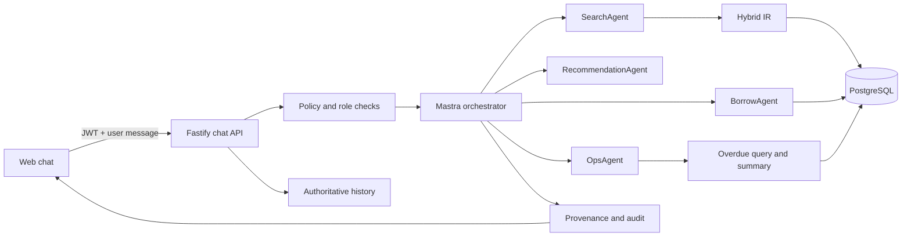

# LibraAI Code-Level Remediation Plan

**Purpose:** Assignment rubric completion and critical production hardening  
**Architecture:** Fastify REST with Mastra agent handoffs  
**Date:** 8 October 2026

## Objective

Implement every rubric-relevant code gap plus critical production hardening while preserving LibraAI's existing Fastify REST and Mastra architecture.

## Scope

### Included

- JWT, CORS, request-limit, and rate-limit hardening
- Server-authoritative conversation history
- Privacy-minimized AI action auditing
- Explicit NLP entity extraction and summarization
- An operational specialist agent for overdue-loan workflows
- Responsible AI refusal and tool-authorization controls
- Versioned agent, tool, and retrieval provenance
- User-facing AI transparency and explainability
- Reproducible NLP, IR, routing, and safety evaluation
- Test coverage, repository checks, and CI

### Excluded

- MCP integration
- Cookie-based authentication migration
- PostgreSQL row-level security
- Billing and plan enforcement
- Enterprise observability infrastructure
- Final report writing
- Video production
- Market-analysis prose

## Target architecture



The browser sends one authenticated user message and an optional conversation ID. Fastify validates identity, policy, limits, and conversation ownership before loading authoritative history. The Mastra orchestrator delegates to a specialist agent. Tools query organization-scoped PostgreSQL data and retrieval indexes. The response includes answer content, safe provenance, and append-only audit events.

## 1. Harden authentication, environment, CORS, limits, and throttling

### Target outcome

All security-sensitive defaults fail closed, and abuse-prone routes have explicit limits.

### Changes

- Make the JWT `role` claim mandatory in `apps/api/src/types/fastify-jwt.d.ts`.
- Reject missing or invalid roles in `apps/api/src/plugins/auth.ts`.
- Remove the missing-role-to-owner fallback from `apps/api/src/lib/org.ts`.
- Make the web role parser fail closed when a role is missing.
- Add focused request-limit, CORS parsing, and production-environment guard modules.
- Enforce strong production JWT secrets.
- Prohibit production `MASTRA_DEV_*` tenant overrides.
- Wire `CORS_ORIGIN` into the Fastify CORS configuration.
- Reject wildcard CORS in production.
- Bound authentication and AI-chat payload sizes.
- Add `@fastify/rate-limit` with separate limits for:
  - Login and signup by IP
  - AI chat by authenticated user and organization
  - AI recommendation generation
- Preserve the existing `{ "message": "..." }` API error shape.
- Update JWT fixtures and existing tests that issue owner tokens without a role.

### Acceptance criteria

- [ ] A token without a valid role receives `401` instead of owner access.
- [ ] Production startup rejects weak JWT secrets.
- [ ] Production startup rejects development tenant overrides.
- [ ] Only configured origins receive CORS approval.
- [ ] Oversized authentication and chat payloads are rejected.
- [ ] Excessive login, signup, chat, and recommendation requests produce deterministic `429` responses.

## 2. Replace client-controlled chat history with authoritative conversations

### Target outcome

Only new user messages cross the client trust boundary. Previous assistant messages and tool outcomes come from server-owned conversation history.

### Changes

- Add `chat_conversations` and `chat_messages` to `packages/db/src/schema.ts`.
- Generate a Drizzle migration containing:
  - Organization ID
  - Actor ID
  - Actor role
  - Conversation timestamps
  - Message role and content
  - Scoped ownership indexes
- Create a focused conversation repository that:
  - Creates conversations
  - Verifies conversation ownership
  - Appends user and assistant turns
  - Loads only the latest bounded history
- Change `POST /ai/chat` to accept:

```json
{
  "conversationId": "optional-uuid",
  "message": "user message"
}
```

- Reject the legacy body containing client-supplied assistant messages.
- Update `apps/web/lib/chat.ts` and `ChatProvider.tsx` to send one user message.
- Store the returned conversation ID with the local conversation.
- Continue using local storage for UI history while treating server history as the model-context authority.

### Acceptance criteria

- [ ] Multi-turn borrowing works without sending assistant messages from the browser.
- [ ] Cross-organization conversation access is denied.
- [ ] Cross-user conversation access is denied.
- [ ] Forged assistant content is rejected.
- [ ] Message length and history-size limits are enforced.
- [ ] Conversation IDs survive client reloads.

## 3. Add privacy-minimized, append-only AI action auditing

### Target outcome

Important AI operations are attributable and reviewable without storing unnecessary personal information.

### Changes

- Add an `ai_action_events` table with:
  - Organization ID
  - Actor ID and role
  - Conversation ID
  - Agent and tool identifiers
  - Event kind and outcome
  - Resource type and ID
  - Redacted metadata
  - Input digest
  - Creation timestamp
- Expose insert-only repository functions.
- Do not create update or delete API routes for audit events.
- Wrap Mastra tool execution to record:
  - Invocation
  - Successful result
  - Failure
  - Denial
  - Chat completion
- Hash or summarize tool input instead of storing raw prompts.
- Remove email and unnecessary names from LLM-facing member and borrow tool outputs.
- Exclude the following from audit metadata:
  - Email addresses
  - Phone numbers
  - Passwords and password hashes
  - JWTs and API keys
  - Raw chat content

### Acceptance criteria

- [ ] Successful, failed, and denied actions create correctly scoped events.
- [ ] Audit events can only be inserted through application interfaces.
- [ ] Tests verify that protected PII never appears in audit metadata.
- [ ] Cross-tenant events cannot be read or attributed incorrectly.

## 4. Make NLP explicit and integrate it with hybrid retrieval

### Target outcome

The project has a named and testable NLP module rather than relying only on implicit LLM interpretation.

### Changes

- Create `apps/api/src/nlp/catalog-entities.ts`.
- Define typed extraction for:
  - Quoted and unquoted book titles
  - Author phrases
  - ISBN-10 and ISBN-13
  - Canonical genres
  - Topic terms
  - Source spans
  - Deterministic confidence
- Reuse existing query normalization and ISBN handling.
- Feed extracted entities into `search-books` and `search-catalog.ts`.
- Add genre matching and ranking support to `search-rank.ts`.
- Populate structured IR source records from keyword and vector hits with:
  - Book ID
  - Title
  - ISBN
  - Retrieval method
  - Match type
  - Score
- Add golden fixtures for NLP extraction and retrieval behavior.

### Acceptance criteria

- [ ] Entity extraction is deterministic and API-key-free.
- [ ] ISBN, title, author, genre, mixed, ambiguous, and empty queries are tested.
- [ ] Extracted entities materially influence ranking.
- [ ] Keyword-only, vector-only, and fused results expose accurate source metadata.
- [ ] Existing retrieval-query tests continue to pass.

## 5. Implement overdue-loan summarization through a new OpsAgent

### Target outcome

The planned operational demo is supported by explicit summarization and an operational specialist agent.

### Changes

- Extract an organization-scoped `listOverdueLoans` query shared by REST and Mastra tools.
- Enforce owner-all versus member-self scope in SQL.
- Create `apps/api/src/nlp/overdue-summary.ts`.
- Return:
  - A summary headline
  - Bounded bullet items
  - Loan and member totals
  - A truncation indicator
- Add a `list-overdue-loans` tool.
- Add an owner-only `get-member` tool.
- Create and register `ops-agent.ts`.
- Extend orchestrator routing for:
  - Overdue-loan questions
  - Member operational queries
  - Loan status summaries

### Acceptance criteria

- [ ] Empty, single, and truncated summaries are grammatically correct.
- [ ] Returned loans are excluded.
- [ ] Days-overdue calculations are calendar-safe.
- [ ] Owners can retrieve organization-wide overdue data.
- [ ] Members can retrieve only their own overdue data.
- [ ] Tenant and role isolation are proven by integration tests.
- [ ] The orchestrator exposes and delegates to `OpsAgent`.

## 6. Add Responsible AI policy, tool authorization, and protocol metadata

### Target outcome

Safety behavior is enforced independently of prompts, and the communication flow is observable through a stable contract.

### Changes

- Add a deterministic pre-LLM request policy.
- Refuse:
  - Bulk deletion or destructive actions
  - Authentication and authorization bypass requests
  - Cross-tenant data requests
  - Bulk PII export
- Continue allowing valid search, recommendation, borrow, and overdue requests.
- Add a tool-authorization map for owner and member roles.
- Enforce tool authorization independently of prompt instructions.
- Ensure policy refusals:
  - Do not invoke an LLM
  - Do not execute tools
  - Produce a denied audit event
- Define versioned REST/Mastra metadata containing:
  - Delegated agent IDs
  - Tool IDs
  - Redacted input and output summaries
  - Retrieval sources
  - Extracted entities
  - Refusal code
  - Timing
- Extract metadata from Mastra steps and sub-agent results.
- Do not expose chain-of-thought, hidden prompts, or private intermediate reasoning.

### Acceptance criteria

- [ ] “Delete all members” is refused without an LLM or tool call.
- [ ] Members cannot invoke owner-only tools.
- [ ] Cross-tenant requests are refused.
- [ ] Agent and tool identifiers remain stable through contract tests.
- [ ] Response metadata includes a protocol version.
- [ ] Refusal responses include a stable machine-readable code.

## 7. Surface transparency and explainability in the web UI

### Target outcome

Users can identify AI-generated content and inspect the agents, tools, and catalog evidence used.

### Changes

- Mirror and validate response metadata in `apps/web/lib/chat.ts`.
- Persist metadata with assistant messages.
- Add a compact `ChatProvenancePanel` showing:
  - Delegated specialist
  - Tools used
  - Catalog sources
  - Retrieval method
  - Recommendation basis
- Add reusable disclosure, limitation, and privacy copy to:
  - Chat landing
  - Full chat thread
  - Floating chat widget
  - Recommendations
  - Settings
- Identify AI-generated recommendations separately from catalog fallbacks.
- Do not display:
  - Chain-of-thought
  - Raw prompts
  - Private member profiles
  - Tool payload PII
- Follow the local Next.js 16 documentation before changing app-router APIs.

### Acceptance criteria

- [ ] Metadata survives local storage reloads.
- [ ] Provenance renders consistently in full-page and widget chat.
- [ ] Empty provenance sections remain hidden.
- [ ] Assistant and provenance content remain safely escaped.
- [ ] Recommendation source labels are covered by component tests.
- [ ] Disclosure variants are covered by tests.

## 8. Add reproducible NLP, IR, routing, and safety evaluation

### Target outcome

Assignment evaluation results can be regenerated from versioned inputs instead of being manually created.

### Changes

- Create versioned fixtures for:
  - Catalog entity extraction
  - IR relevance
  - Agent-routing prompts
  - Safety refusal prompts
- Add scorers for:
  - Entity field accuracy
  - Recall@K
  - Mean Reciprocal Rank
  - Routing accuracy
  - Refusal precision and recall
  - Protocol-metadata completeness
- Keep the default evaluation deterministic and API-key-free.
- Add a separate opt-in live-agent evaluation mode.
- Add an evaluation CLI that writes:
  - `manifest.json`
  - `results.json`
  - `report.md`
- Include:
  - Git revision
  - Fixture hashes
  - Metric summaries
  - Failed cases
  - Latency when available
- Add `eval` scripts to the API package, root package, and Justfile.

### Acceptance criteria

- [ ] Default evaluation runs without paid API calls.
- [ ] Scorer mathematics have automated tests.
- [ ] Report generation has automated tests.
- [ ] Generated reports are traceable to a code revision and fixture set.
- [ ] Integration evaluation can run against the seeded PostgreSQL catalog.

## 9. Establish repository-wide verification and CI

### Target outcome

Critical behavior is checked consistently before merge and deployment.

### Changes

- Add root scripts for:
  - `test`
  - `test:web`
  - `test:api`
  - `lint`
  - `build`
  - `check`
  - `test:coverage`
  - `eval`
- Update the Justfile so test and check recipes cover API and web.
- Add `@vitest/coverage-v8`.
- Configure reporting-first coverage for:
  - API Mastra code
  - API routes and security libraries
  - Web chat libraries and components
- Do not impose arbitrary high coverage thresholds initially.
- Add `.github/workflows/ci.yml` with:
  - pnpm dependency caching
  - pgvector PostgreSQL service
  - Database migration
  - API tests
  - Web tests
  - Lint checks
  - Production builds
  - Coverage artifacts
  - Deterministic evaluation
- Update code-adjacent README, protocol, Responsible AI, and evaluation instructions after implementation.
- Correct or archive the stale implementation-status document.

### Acceptance criteria

- [ ] A clean checkout passes the complete `check` command.
- [ ] CI uses the same migrations and commands as local development.
- [ ] Coverage output is retained as a CI artifact.
- [ ] Evaluation output is retained as a CI artifact.
- [ ] No default test or evaluation requires a paid API call.

## Execution order

1. Security baseline: JWT roles, production guards, CORS, payload limits, and rate limiting.
2. Authoritative chat schema, migration, repository, API contract, and web migration.
3. Append-only AI auditing and PII minimization.
4. Catalog entity extraction and structured IR source attribution.
5. Overdue query, summarization, tools, and OpsAgent.
6. Responsible AI policy, tool authorization, versioned metadata, and contract tests.
7. Frontend provenance and AI disclosure.
8. Evaluation fixtures, scorers, CLI, and generated reports.
9. Root verification commands, coverage, CI, and technical documentation.

Each work package should be independently reviewable and must finish with its focused tests passing.

## Verification gates

### Development gate

- Follow red-green-refactor for every work package.
- Write a failing test before each behavior change.
- Implement the smallest correct change.
- Run focused tests before broader suites.

### Final automated gate

```bash
pnpm install --frozen-lockfile
pnpm db:migrate
pnpm check
pnpm test:coverage
pnpm eval
```

### Final manual gate

- [ ] Complete a user-only, multi-turn borrowing flow.
- [ ] Retrieve an organization-wide overdue summary as an owner.
- [ ] Retrieve only personal overdue loans as a member.
- [ ] Verify that a destructive request is refused.
- [ ] Inspect agent, tool, and retrieval provenance in the UI.
- [ ] Verify that a disallowed origin does not receive CORS approval.
- [ ] Trigger and verify a rate-limit response.
- [ ] Inspect audit rows and verify that they contain no protected PII.

### Final review focus

- Tenant isolation
- Fail-closed authentication and authorization
- Database migration compatibility
- No chain-of-thought in API or UI metadata
- No PII in provenance or audit metadata
- Deterministic tests without paid API calls
- Stable agent and tool contracts

## Expected assignment evidence

- **Multi-agent requirement:** Orchestrator plus Search, Recommendation, Borrow, and Ops specialists with tested handoff contracts.
- **NLP requirement:** Deterministic catalog entity extraction and overdue-loan summarization with golden fixtures and metrics.
- **Information retrieval requirement:** Hybrid retrieval with source metadata and Recall@K/MRR results.
- **Security requirement:** Authentication, authorization, input bounds, CORS, rate limits, tenant isolation, and privacy-minimized auditing.
- **Responsible AI requirement:** Explicit refusals, tool authorization, transparency, safe provenance, privacy disclosures, and reproducible safety evaluation.
- **Communication protocol requirement:** Versioned REST response and Mastra handoff metadata with contract tests.
- **Evaluation requirement:** Generated JSON and Markdown reports tied to a git revision and fixture hashes.

## Completion checklist

- [ ] Authentication, environment, CORS, payload-limit, and throttling changes complete
- [ ] Server-authoritative conversations complete
- [ ] Privacy-minimized AI auditing complete
- [ ] Explicit catalog NLP and retrieval-source attribution complete
- [ ] OpsAgent and overdue summarization complete
- [ ] Responsible AI policy and protocol metadata complete
- [ ] Frontend transparency and explainability complete
- [ ] Reproducible evaluation harness complete
- [ ] Repository-wide checks, coverage, and CI complete
- [ ] All database migrations apply to clean and existing development databases
- [ ] API and web tests pass
- [ ] Lint and production builds pass
- [ ] Coverage and deterministic evaluation pass
- [ ] Technical documentation matches implemented behavior
